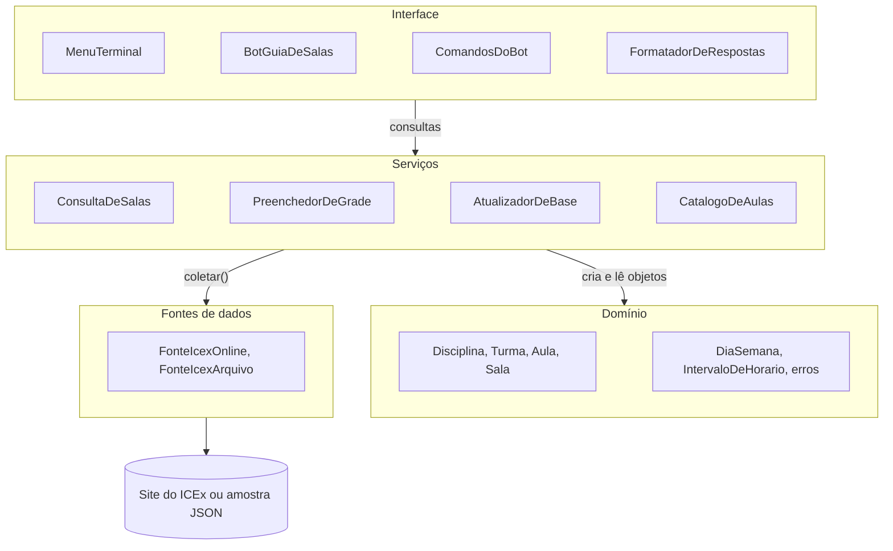
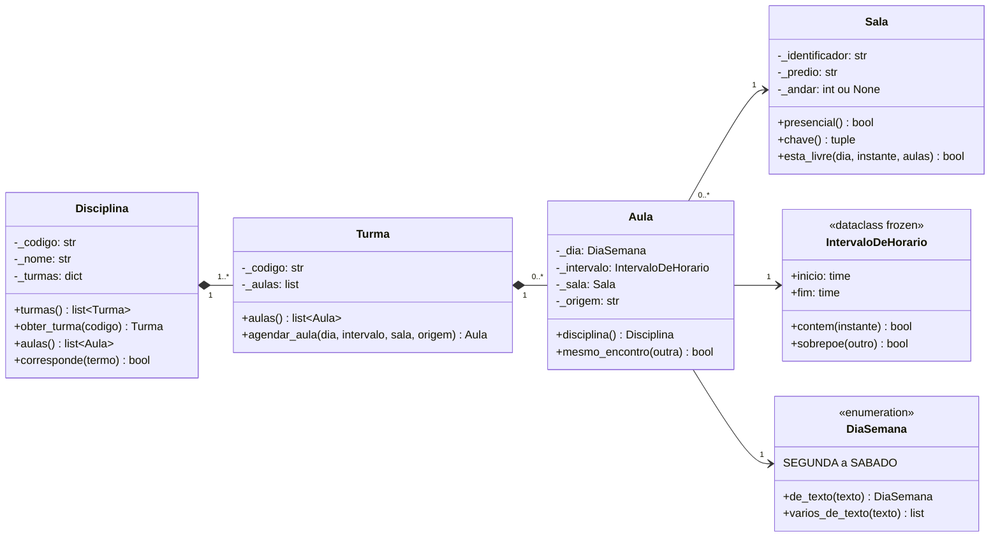
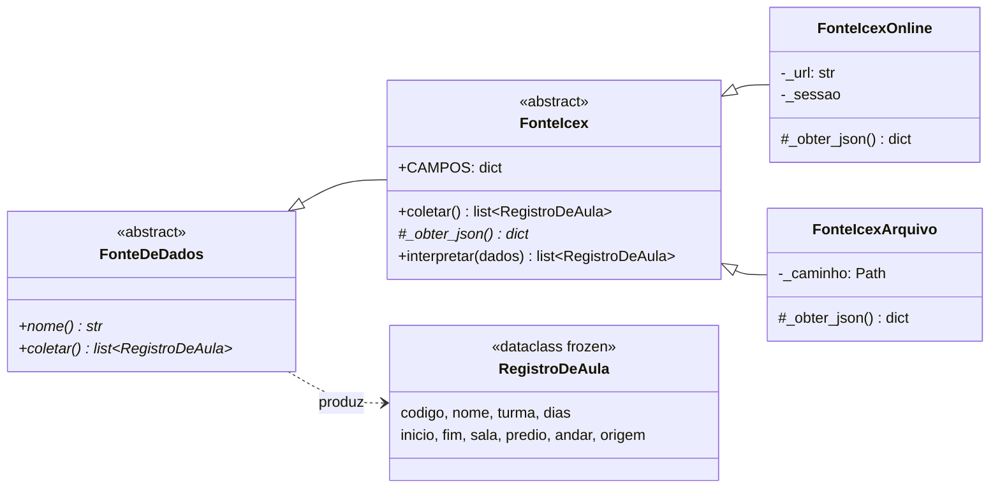
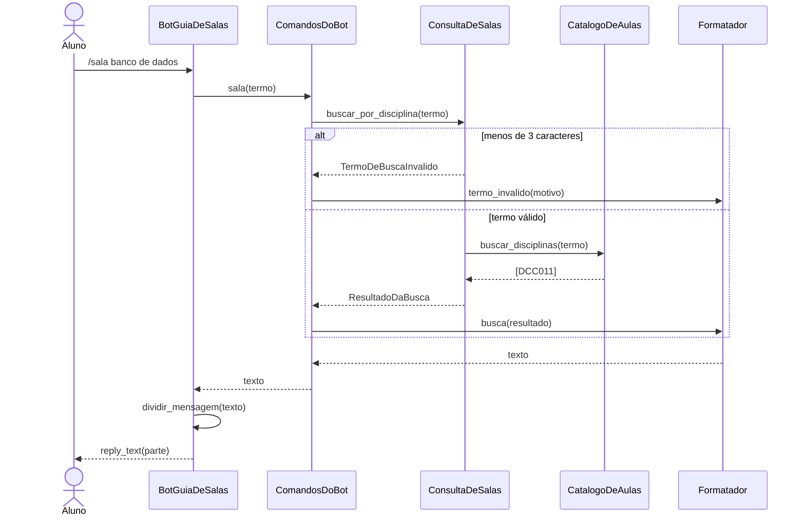

# Guia de Salas: como o sistema funciona e próximos passos

Natan Gaspar de Souza

Versão do código descrita: 0.1.0 (protótipo da 3ª etapa, novembro de 2026). Escopo atual: somente o quadro de salas do ICEx.

## 1. Visão geral

O Guia de Salas responde a duas perguntas do aluno:

- **F01, onde é a aula?** O aluno informa o nome ou o código de uma disciplina e recebe as turmas, os dias, os horários e as salas.
- **F02, qual sala está livre?** O aluno informa dia, hora, andar e, se quiser, o prédio, e recebe as salas sem aula naquele instante.

Há ainda uma terceira função, já implementada para o bot: o aluno envia uma planilha `.xlsx` com as disciplinas e recebe a mesma planilha preenchida com turma, horários e sala.

Os dados vêm do JSON que a própria página do ICEx usa (`recupera_salas.php`). O programa lê esse JSON, valida cada registro, monta em memória um catálogo de disciplinas, turmas, aulas e salas e responde às consultas a partir dele. O mesmo núcleo atende três interfaces: o menu do terminal (padrão), o bot do Telegram (`--telegram`) e o script de download dos dados.

O código está organizado em camadas. Cada camada só conhece as camadas abaixo dela, o que permite trocar a interface (terminal ou Telegram) ou a origem dos dados (arquivo ou site) sem mexer nas regras.



<p class="legenda">Figura 1. Camadas do sistema e dependências principais.</p>

## 2. Pacotes e módulos

| Pacote ou módulo | Responsabilidade | Conteúdo principal |
|---|---|---|
| `guia_salas/__main__.py` | Ponto de entrada (`python -m guia_salas`) | `main()`, `iniciar_telegram()` |
| `guia_salas/configuracao.py` | Leitura das variáveis de ambiente | `Configuracao` |
| `guia_salas/texto.py` | Normalização de texto para a busca | `normalizar()`, `palavras()` |
| `guia_salas/terminal.py` | Menu de texto do protótipo | `MenuTerminal` |
| `guia_salas/dominio/` | Conceitos e regras do problema | `Disciplina`, `Turma`, `Aula`, `Sala`, `DiaSemana`, `IntervaloDeHorario`, exceções |
| `guia_salas/fontes/` | Obter os registros brutos de aulas | `FonteDeDados`, `FonteIcex`, `FonteIcexOnline`, `FonteIcexArquivo`, `RegistroDeAula` |
| `guia_salas/servicos/` | Montar a base e executar as consultas | `AtualizadorDeBase`, `CatalogoDeAulas`, `ConsultaDeSalas`, `PreenchedorDeGrade` |
| `guia_salas/bot/` | Tudo o que é específico do Telegram e dos textos de resposta | `BotGuiaDeSalas`, `ComandosDoBot`, `FormatadorDeRespostas`, `dividir_mensagem()` |
| `guia_salas/dados/` | Amostra real do ICEx (110 registros de 15/10/2026) | `amostra_icex.json` |
| `tests/` | 19 testes `unittest` com 11 registros reais conhecidos | `test_busca_disciplina.py`, `test_salas_livres.py`, `test_fontes.py`, `test_menu.py` |
| `scripts/` | Download da lista completa e verificação manual da Aula 17 | `baixar_dados_icex.py`, `verificacao_manual_aula17.py` |

Somente o pacote `bot/aplicacao.py` importa a biblioteca `python-telegram-bot`. Os comandos (`ComandosDoBot`) recebem e devolvem texto puro, então podem ser testados sem Telegram e sem internet.

## 3. Classes e objetos

### 3.1 Domínio



<p class="legenda">Figura 2. Classes do domínio.</p>

| Classe | O que representa | Regras que garante |
|---|---|---|
| `Disciplina` | Uma disciplina do semestre, identificada pelo código (ex.: DCC011) | Código e nome não vazios; código guardado em maiúsculas e sem espaços. `corresponde(termo)` decide se a disciplina atende à busca. |
| `Turma` | Uma oferta da disciplina (TB, TE, TM2/TN3) | É criada só por `Disciplina.obter_turma()`. `agendar_aula()` ignora uma aula repetida e lança `ConflitoDeHorario` se a mesma turma tiver duas aulas sobrepostas no mesmo dia. |
| `Aula` | Um encontro semanal: turma, dia, intervalo, sala e fonte de origem | Criada só por `Turma.agendar_aula()`. |
| `Sala` | Espaço físico identificado por prédio e identificador | Identificador e prédio não vazios, andar não negativo. Duas salas são iguais quando têm a mesma chave (prédio, identificador), sem diferenciar maiúsculas. Aulas "ON-LINE" usam o prédio "On-line", que não é presencial. |
| `IntervaloDeHorario` | Início e fim de uma aula (objeto de valor imutável) | Início anterior ao fim. O fim é exclusivo: uma aula de 09:25 a 11:05 não ocupa a sala às 11:05. |
| `DiaSemana` | Enumeração de segunda a sábado | Aceita "Seg", "terça", "2ª", "SEG QUA", "Ter-Qui". |
| `ErroDeDominio` e subclasses | Falhas de regra: `DadoInvalido`, `ConflitoDeHorario`, `TermoDeBuscaInvalido`, `PredioDesconhecido` | Todas herdam de `ErroDeDominio`, então a interface trata qualquer recusa com um único `except`. |

O encapsulamento segue um padrão: os atributos são privados (`_codigo`, `_aulas`), a leitura é feita por propriedades e a criação dos objetos dependentes passa pelo objeto dono. Assim não existe `Turma` sem `Disciplina` nem `Aula` sem `Turma`, e as regras de conflito ficam num único lugar.

### 3.2 Fontes de dados



<p class="legenda">Figura 3. Hierarquia das fontes de dados.</p>

- **`FonteDeDados`** é a interface comum: toda fonte tem um `nome` e um método `coletar()` que devolve uma lista de `RegistroDeAula`, ainda sem validação. Uma fonte que não responde lança `FonteIndisponivel`.
- **`FonteIcex`** sabe ler o formato do ICEx (`{"records": [...]}`) e traduzir os campos (`nome_materia`, `codigo_materia`, `turma`, `hora_inicial`, `hora_final`, `dia_semana`, `nome_sala`). Ela usa o padrão Template Method: `coletar()` chama `_obter_json()`, que cada subclasse implementa.
- **`FonteIcexOnline`** baixa o JSON pelo `requests`. A sessão HTTP pode ser injetada, o que permite testar sem internet.
- **`FonteIcexArquivo`** lê uma cópia local, como a amostra em `dados/`.
- Funções auxiliares: `separar_predio("CAD3 - Sala 310")` devolve `("CAD3", "310")`; `andar_pelo_numero("1024")` devolve 1 (o andar é o primeiro dígito do número da sala).

### 3.3 Serviços

| Classe | Papel | Métodos principais |
|---|---|---|
| `AtualizadorDeBase` | Monta um catálogo novo a partir de todas as fontes configuradas | `atualizar()` devolve `(CatalogoDeAulas, RelatorioDeAtualizacao)`. `incluir(catalogo, registro)` converte um registro em uma ou mais aulas (uma por dia da semana). |
| `RelatorioDeAtualizacao` | Resumo da carga | Registros lidos, aulas registradas, registros recusados com o motivo, fontes com falha. |
| `CatalogoDeAulas` | Base em memória: disciplinas por código e salas por chave | `registrar_aula()`, `buscar_disciplinas(termo)`, `salas_livres(dia, instante, andar, predio)`, `disciplina_por_codigo()`, `predios`, `turmas_na_sala()`. |
| `ConsultaDeSalas` | Fachada das consultas F01 e F02, usada por todas as interfaces | `buscar_por_disciplina(termo)` devolve `ResultadoDaBusca`; `salas_livres(...)` devolve `list[Sala]`; `trocar_catalogo(novo)` troca a base sem reiniciar o bot. |
| `ResultadoDaBusca` | Termo pesquisado e disciplinas encontradas | `encontrou` |
| `PreenchedorDeGrade` | Completa uma planilha do aluno | `preencher(entrada, saida)` devolve `(localizadas, nao_localizadas)`. |

`ConsultaDeSalas` concentra as validações de entrada (termo com pelo menos 3 caracteres, andar não negativo, prédio existente na base). `CatalogoDeAulas` só executa a busca, então pode ser usado diretamente pelos testes.

### 3.4 Interface com o usuário

| Classe ou função | Papel |
|---|---|
| `MenuTerminal` | Menu do protótipo. Recebe as funções `ler` e `escrever` por parâmetro (por padrão `input` e `print`), o que permite testá-lo com entradas simuladas. |
| `BotGuiaDeSalas` | Cria a `Application` do `python-telegram-bot`, registra os tratadores de comandos e agenda a atualização periódica da base na `job_queue`. |
| `ComandosDoBot` | Traduz o texto de cada comando (`/sala`, `/livres`, `/ajuda`) em chamadas à `ConsultaDeSalas` e devolve a resposta em texto. Não depende do Telegram. |
| `FormatadorDeRespostas` | Transforma resultados em mensagens. Agrupa dias com o mesmo horário e sala ("Seg/Qua 09:25-11:05"). É usado pelo terminal e pelo bot, por isso as respostas são iguais nos dois. |
| `dividir_mensagem(texto)` | Quebra respostas maiores que 4000 caracteres em várias mensagens (o Telegram aceita até 4096), sempre entre linhas. |

### 3.5 Funções de apoio

- `normalizar(texto)` remove acentos, converte para minúsculas e compacta espaços.
- `palavras(texto)` divide o texto normalizado em palavras e troca algarismos de 1 a 9 por romanos, para que "Cálculo 2" encontre "CALCULO DIFERENCIAL E INTEGRAL II".
- `ler_hora(texto)` aceita "7:30", "07:30" e "07h30".
- `Configuracao.do_ambiente()` lê `TELEGRAM_TOKEN`, `GUIA_SALAS_DADOS_ICEX` (endereço ou arquivo) e `GUIA_SALAS_INTERVALO_MIN` (padrão 60). `criar_fontes()` escolhe `FonteIcexOnline` para endereços http(s) e `FonteIcexArquivo` para caminhos locais.

### 3.6 Objetos em execução

Com a amostra, o programa mantém em memória um único `CatalogoDeAulas` com 30 objetos `Disciplina`, suas turmas, 199 objetos `Aula` e 43 objetos `Sala` em quatro prédios (CAD1, CAD2, CAD3, ICEx). Cada `Sala` existe uma única vez e é compartilhada por todas as aulas que acontecem nela; é isso que permite a F02 saber o que está ocupado. No bot, há também um `BotGuiaDeSalas`, um `ComandosDoBot`, um `PreenchedorDeGrade` e um `AtualizadorDeBase`, todos apontando para a mesma `ConsultaDeSalas`. Quando a atualização periódica termina, só o catálogo dentro da consulta é trocado.

## 4. Fluxos de execução no bot do Telegram

### 4.1 Inicialização

Comando: `python -m guia_salas --telegram`.

1. `iniciar_telegram()` lê a `Configuracao` das variáveis de ambiente e encerra com aviso se `TELEGRAM_TOKEN` estiver vazio.
2. `Configuracao.criar_fontes()` cria a fonte (online por padrão).
3. `AtualizadorDeBase.atualizar()` chama `coletar()` de cada fonte, passa cada registro por `incluir()` e registra no log o relatório (lidos, registrados, recusados).
4. Uma `ConsultaDeSalas` é criada com o catálogo e entregue ao `BotGuiaDeSalas`, que registra os tratadores e agenda a atualização a cada `GUIA_SALAS_INTERVALO_MIN` minutos.
5. `executar()` inicia o `run_polling()`: o bot passa a perguntar ao Telegram por mensagens novas.

### 4.2 Comando /sala



<p class="legenda">Figura 4. Sequência do comando /sala (Formatador é o FormatadorDeRespostas; o Telegram entrega a mensagem ao BotGuiaDeSalas por um CommandHandler).</p>

A busca primeiro tenta o código exato. Se não houver, compara palavras: cada palavra do termo precisa ser igual ou ser o começo (com pelo menos 3 letras) de alguma palavra do nome. Exemplo de resposta real com a amostra:

```text
DCC011 - INTRODUCAO A BANCO DE DADOS
  TB: Seg/Qua 09:25-11:05, sala 2014 - DCC (ICEx, 2º andar)
  TE: Ter/Qui 19:00-20:40, sala 213 (CAD3, 2º andar)
```

### 4.3 Comando /livres

Formato: `/livres <dia> <hora> <andar> [prédio]`, por exemplo `/livres seg 9:30 2 icex`.

1. `ComandosDoBot.livres()` separa os argumentos e converte dia (`DiaSemana.de_texto`), hora e andar. Com menos de três argumentos ou valores inválidos, devolve a mensagem de uso.
2. `ConsultaDeSalas.salas_livres()` valida o andar e o prédio (prédio desconhecido gera `PredioDesconhecido` com a lista de prédios existentes).
3. `CatalogoDeAulas.salas_livres()` percorre as salas presenciais, aplica os filtros e pergunta a cada `Sala` se está livre (`esta_livre`), comparando com todas as aulas daquele dia.
4. `FormatadorDeRespostas.salas_livres()` monta a lista ou o aviso de que nenhuma sala está livre.

```text
Salas livres no 2º andar (Segunda, 09:30):
  2008 - MAT (ICEx)
  2009 - DCC (ICEx)
  2013 - DCC (ICEx)
  2015 - DCC (ICEx)
  2031 (ICEx)
  2032 MAT (ICEx)
```

### 4.4 Envio de planilha

Quando o aluno envia um documento `.xlsx`, `BotGuiaDeSalas._grade()` baixa o arquivo para uma pasta temporária e chama `PreenchedorDeGrade.preencher()`. Para cada linha, a primeira coluna é usada como termo de busca e, se existir uma coluna "Turma", ela escolhe a turma. Três colunas são acrescentadas (Turma encontrada, Dias e horários, Sala) e a planilha volta para o aluno com o total de disciplinas localizadas. Fotos recebem a resposta de que só planilhas são aceitas.

### 4.5 Atualização periódica

A cada intervalo, `_atualizar_base()` executa um `AtualizadorDeBase.atualizar()` completo e chama `ConsultaDeSalas.trocar_catalogo()`. Se o catálogo novo vier vazio (site fora do ar, por exemplo), a troca é recusada e o bot continua respondendo com a base anterior. O relatório vai para o log.

## 5. Regras de negócio que merecem atenção

| Regra | Implementação | Motivo |
|---|---|---|
| Fim de aula exclusivo | `IntervaloDeHorario.contem()` usa `inicio <= instante < fim` | A sala fica livre exatamente no horário de término. |
| Turmas conjuntas | Turmas diferentes podem dividir sala e horário | O quadro real tem casos como DCC006-TL1 e DCC017-TN na sala 407 do CAD3. |
| Conflito na mesma turma | `Turma.agendar_aula()` lança `ConflitoDeHorario` | Uma turma não pode estar em dois lugares ao mesmo tempo; o registro é recusado e aparece no relatório. |
| Dias compostos | "Ter-Qui" vira duas aulas (terça e quinta) | "Seg-Sex" é lido como segunda e sexta; ainda falta confirmar. |
| Andar | Primeiro dígito do número da sala | Fica desconhecido em salas sem número, como "AUD. II". |
| Salas conhecidas | Só existem salas que aparecem em alguma aula | Uma sala sem nenhuma aula no semestre nunca aparece como livre. |
| Registros inválidos | Recusados um a um, sem interromper a carga | Um registro com horário quebrado não derruba a base inteira. |

## 6. Comandos disponíveis hoje

| Comando | Exemplo | Resposta |
|---|---|---|
| `/start`, `/ajuda`, `/help` | `/ajuda` | Lista de comandos com exemplos. |
| `/sala <nome ou código>` | `/sala calculo 2`, `/sala DCC011` | Turmas, dias, horários e salas de cada disciplina encontrada. |
| `/livres <dia> <hora> <andar> [prédio]` | `/livres ter 14:00 1`, `/livres seg 10:00 3 cad3` | Salas sem aula no instante informado. |
| Planilha `.xlsx` | Arquivo com as disciplinas na primeira coluna | A mesma planilha com turma, horários e sala. |

Para executar o bot: instalar as dependências (`pip install -r requirements.txt`), definir `TELEGRAM_TOKEN` com o token criado no BotFather e rodar `python -m guia_salas --telegram`.

## 7. Situação atual

| Item | Situação |
|---|---|
| F01 e F02 no terminal com a amostra | Funcionando; 19 testes automatizados passando. |
| Modo `--online` | Implementado; não executado no ambiente de desenvolvimento, que não alcança o site do ICEx. |
| Bot do Telegram | Implementado; ainda não testado com um token real. |
| Preenchimento de planilha | Implementado; sem testes automatizados. |
| Persistência | Não existe: a base é refeita na memória a cada início. |
| Escola de Engenharia | Fora do escopo nesta fase. |

## 8. Melhorias futuras

As melhorias estão agrupadas na ordem sugerida de execução. As da primeira fase saíram da leitura do código atual; as demais vêm das pendências registradas e da proposta do projeto.

### 8.1 Fase 1: deixar o bot pronto para uso real

| Melhoria | Situação no código hoje | O que mudar |
|---|---|---|
| Primeiro teste com token real e `--online` | Nunca executados | Criar o bot no BotFather, rodar com a lista completa do ICEx e registrar quantos registros são recusados. |
| Testes do bot | Não há testes de `ComandosDoBot`, `dividir_mensagem` e `PreenchedorDeGrade` | Criar testes com o mesmo catálogo de `tests/dados/`, sem Telegram, já que os comandos recebem e devolvem texto. |
| Atualização sem travar o bot | `_atualizar_base()` e `_grade()` são assíncronos, mas chamam código síncrono (download HTTP, leitura da planilha); enquanto rodam, o bot não responde a ninguém | Executar essas chamadas com `asyncio.to_thread()`. |
| Tratamento de erros | Não há `add_error_handler`; uma exceção inesperada fica só no log e o aluno não recebe resposta | Registrar um tratador que responde "Não foi possível responder agora" e registra o erro. |
| Leitura de hora duplicada | `ComandosDoBot.livres()` converte a hora por conta própria, em vez de usar `ler_hora()` | Usar `ler_hora()`, para que terminal e bot aceitem os mesmos formatos e mostrem as mesmas mensagens de erro. |
| Andar obrigatório no bot | No terminal o andar é opcional; no `/livres` é obrigatório | Aceitar `/livres ter 14:00` para todos os andares. |
| Arquivo devolvido aberto | `saida.open("rb")` em `_grade()` não é fechado | Abrir com `with`. |
| Menu de comandos | Os comandos só aparecem em `/ajuda` | Registrar a lista com `set_my_commands()`, para o Telegram sugerir os comandos ao digitar "/". |

### 8.2 Fase 2: facilitar o uso pelo aluno

- **`/agora [andar] [prédio]`**: salas livres no dia e hora atuais (fuso `America/Sao_Paulo`), sem o aluno digitar dia e hora.
- **Texto sem comando**: tratar uma mensagem como "banco de dados" como se fosse `/sala banco de dados`.
- **Filtro por turma**: `/sala DCC011 TB` mostra só a turma do aluno. Hoje MAT001 tem 24 turmas, o que gera respostas longas.
- **Botões**: quando a busca encontra várias disciplinas, oferecer botões (`InlineKeyboardMarkup`) para escolher uma; no `/livres`, botões para dia e andar, guiados por um `ConversationHandler`.
- **Abreviações**: um dicionário de apelidos ("BD", "GAAL", "AEDS") consultado por `Disciplina.corresponde()` ou pelo catálogo.
- **Turmas conjuntas juntas**: mostrar "DCC006-TL1 e DCC017-TN" lado a lado na mesma sala, a partir de `CatalogoDeAulas.turmas_na_sala()`, que já existe.
- **Validação com colegas** das decisões ainda abertas (todas as turmas ou só uma, abreviações, mínimo de 3 caracteres).

### 8.3 Fase 3: persistência e avisos

- **SQLite** (`sqlite3`, biblioteca padrão), conforme o experimento planejado no protótipo: tabelas disciplina, turma, aula e sala, mais a data da última atualização e os registros recusados. O bot passa a iniciar mesmo com o site fora do ar. Pode entrar como mais uma subclasse de `FonteDeDados` (leitura) e um repositório chamado pelo `AtualizadorDeBase` (gravação).
- **`/minhagrade`**: o aluno salva suas disciplinas e turmas uma vez e consulta tudo com um comando.
- **Aviso de mudança de sala**: comparar o catálogo novo com o anterior em cada atualização e avisar quem salvou aquela turma.
- **Lista completa de salas**: cadastrar as salas existentes, inclusive as que não têm aula, para a F02 não esconder salas sempre livres.
- **Desempenho**: indexar as aulas por dia e sala dentro do `CatalogoDeAulas`. Hoje cada consulta de salas livres percorre todas as aulas, o que é suficiente para cerca de 420 registros, mas cresce com a base.

### 8.4 Fase 4: implantação

- Rodar o bot num servidor (máquina própria ou serviço gratuito), com `run_polling()` ou, mais tarde, webhook.
- Empacotar com um `Dockerfile` e guardar o token só em variável de ambiente.
- Log em arquivo com o relatório de cada atualização, para identificar mudanças no formato do JSON do ICEx.

### 8.5 Fora do escopo atual

- **Escola de Engenharia**: entraria como nova subclasse de `FonteDeDados` (por exemplo `FonteEngenharia`), sem mudança no atualizador nem nas consultas, quando o endereço dos dados for identificado.
- **Grade enviada como imagem**: exigiria reconhecimento de texto (OCR); hoje o bot pede uma planilha.
- **Confirmar o significado de "Seg-Sex"** com a secretaria do ICEx.

## 9. Resumo das classes por funcionalidade

| Funcionalidade | Classes envolvidas |
|---|---|
| Carga da base | `Configuracao`, `FonteDeDados`, `FonteIcex`, `FonteIcexOnline`, `FonteIcexArquivo`, `RegistroDeAula`, `AtualizadorDeBase`, `RelatorioDeAtualizacao`, `CatalogoDeAulas` |
| F01, busca de disciplina | `ComandosDoBot` ou `MenuTerminal`, `ConsultaDeSalas`, `CatalogoDeAulas`, `Disciplina`, `ResultadoDaBusca`, `FormatadorDeRespostas` |
| F02, salas livres | `ComandosDoBot` ou `MenuTerminal`, `ConsultaDeSalas`, `CatalogoDeAulas`, `Sala`, `Aula`, `IntervaloDeHorario`, `DiaSemana`, `FormatadorDeRespostas` |
| Planilha | `BotGuiaDeSalas`, `PreenchedorDeGrade`, `ConsultaDeSalas` |
| Atualização periódica | `BotGuiaDeSalas`, `AtualizadorDeBase`, `ConsultaDeSalas` |
