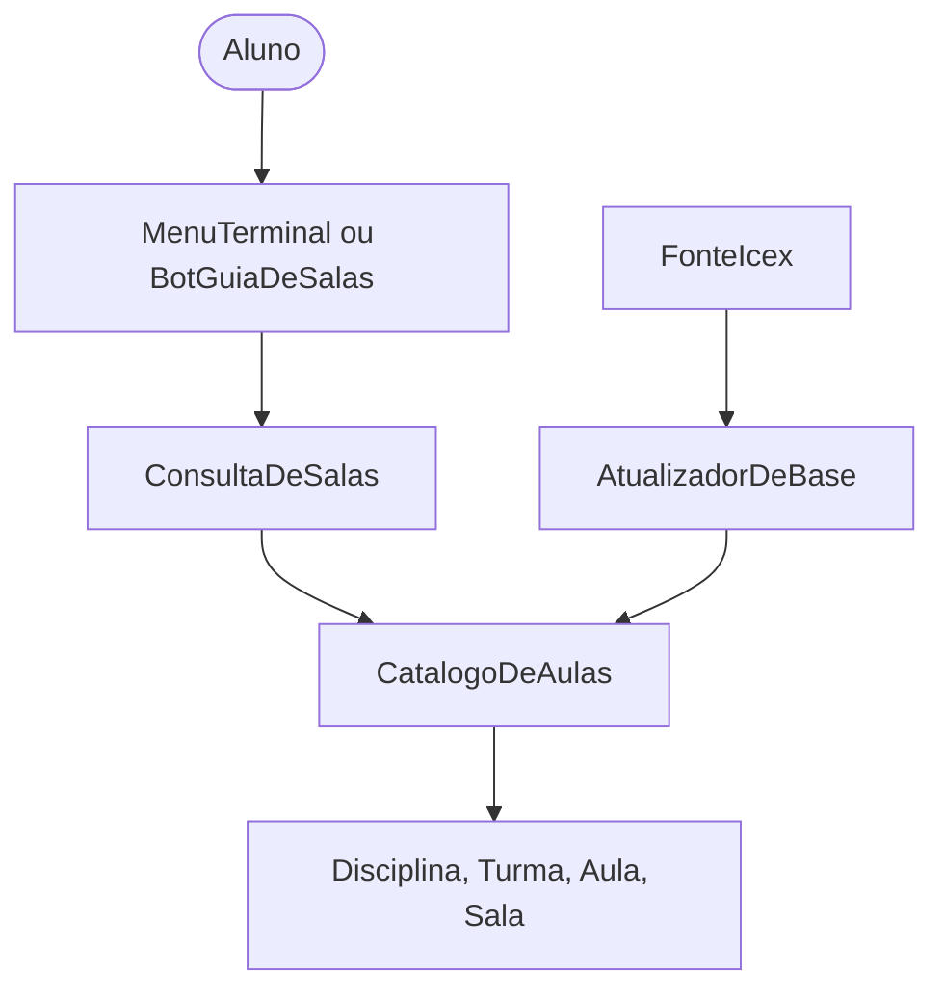

# Guia de Salas: guia rápido de estudo

Natan Gaspar de Souza

Resumo da arquitetura para estudar e apresentar. A versão completa, com todos os métodos e o plano de melhorias, está em `Guia-de-Salas-Arquitetura.pdf`.

## 1. A ideia em uma frase

O programa baixa o quadro de salas do ICEx, transforma cada linha em objetos (disciplina, turma, aula, sala) e responde duas perguntas do aluno: **onde é a aula de tal disciplina** (F01) e **qual sala está livre agora** (F02), pelo terminal ou pelo Telegram.

## 2. Analogia: uma secretaria

| Na secretaria | No código | Faz o quê |
|---|---|---|
| Carteiro que traz a lista de aulas | **Fonte** (`FonteIcexOnline`, `FonteIcexArquivo`) | Busca os dados no site ou num arquivo. |
| Secretário que confere e arquiva | **AtualizadorDeBase** | Valida cada linha e descarta as erradas. |
| Fichário com as fichas | **CatalogoDeAulas** | Guarda todas as disciplinas, turmas, aulas e salas em memória. |
| Atendente do balcão | **ConsultaDeSalas** | Recebe a pergunta, confere se faz sentido e procura no fichário. |
| Quem escreve a resposta | **FormatadorDeRespostas** | Transforma o resultado em texto legível. |
| Porta de entrada | **MenuTerminal** ou **BotGuiaDeSalas** | Recebe o que o aluno digitou e mostra a resposta. |

## 3. Diagrama simples



<p class="legenda">Figura 1. Quem conversa com quem. Na inicialização, o carteiro e o secretário enchem o fichário; depois, cada pergunta passa pela porta, pelo atendente e pelo fichário.</p>

## 4. As classes, uma linha cada

**Domínio (o mundo real)**

- `Disciplina`: código e nome (DCC011, Introdução a Banco de Dados); tem várias turmas.
- `Turma`: uma oferta da disciplina (TB, TE); tem várias aulas.
- `Aula`: um encontro semanal; liga turma, dia, horário e sala.
- `Sala`: lugar físico (2014 - DCC, no ICEx, 2º andar); sabe dizer se está livre.
- `IntervaloDeHorario`: início e fim (09:25-11:05); sabe se contém um instante.
- `DiaSemana`: enumeração de segunda a sábado.
- `ErroDeDominio`: mãe de todos os erros de regra (dado inválido, prédio desconhecido, termo curto).

**Fontes (de onde vêm os dados)**

- `FonteDeDados`: classe abstrata; toda fonte precisa ter `coletar()`.
- `FonteIcex`: abstrata; sabe ler o formato do ICEx.
- `FonteIcexOnline`: baixa do site.
- `FonteIcexArquivo`: lê de um arquivo local.

**Serviços (o trabalho)**

- `AtualizadorDeBase`: junta as fontes e monta o catálogo.
- `CatalogoDeAulas`: guarda tudo e faz as buscas.
- `ConsultaDeSalas`: valida a pergunta e chama o catálogo.
- `PreenchedorDeGrade`: completa uma planilha do aluno com as salas.

**Interface (o que o aluno vê)**

- `MenuTerminal`: menu de texto.
- `BotGuiaDeSalas`: liga o programa ao Telegram.
- `ComandosDoBot`: entende `/sala` e `/livres`, sem depender do Telegram.
- `FormatadorDeRespostas`: monta as mensagens.

## 5. Classe e objeto na prática

**Classe** é o molde; **objeto** é uma coisa concreta criada a partir dele. A classe `Sala` existe uma vez no código; com a amostra, o programa cria 43 objetos `Sala`.

Uma linha do quadro do ICEx:

```text
{"codigo_materia": "DCC011", "nome_materia": "INTRODUCAO A BANCO DE DADOS",
 "turma": "TB", "dia_semana": "Seg-Qua", "hora_inicial": "09:25",
 "hora_final": "11:05", "nome_sala": "2014 - DCC"}
```

vira estes objetos:

```text
Disciplina("DCC011", "INTRODUCAO A BANCO DE DADOS")
  Turma("TB")
    Aula(SEGUNDA, 09:25-11:05, sala 2014 - DCC)
    Aula(QUARTA,  09:25-11:05, sala 2014 - DCC)
Sala("2014 - DCC", predio="ICEx", andar=2)   compartilhada pelas duas aulas
IntervaloDeHorario(09:25, 11:05)
```

Repare: "Seg-Qua" virou **duas** aulas, e as duas apontam para o **mesmo** objeto `Sala`. É por isso que a F02 consegue saber que a sala 2014 está ocupada na segunda às 09:30.

Números com a amostra: 110 linhas lidas, 30 disciplinas, 199 aulas, 43 salas.

## 6. O caminho de uma pergunta no bot

O aluno digita `/sala banco de dados`:

1. `BotGuiaDeSalas` recebe a mensagem do Telegram e repassa o texto para `ComandosDoBot.sala()`.
2. `ComandosDoBot` chama `ConsultaDeSalas.buscar_por_disciplina("banco de dados")`.
3. `ConsultaDeSalas` confere se o termo tem pelo menos 3 letras e pede ao `CatalogoDeAulas` as disciplinas que combinam.
4. Cada `Disciplina` responde se combina com o termo (`corresponde()`); DCC011 combina.
5. `FormatadorDeRespostas` monta o texto e o bot envia:

```text
DCC011 - INTRODUCAO A BANCO DE DADOS
  TB: Seg/Qua 09:25-11:05, sala 2014 - DCC (ICEx, 2º andar)
  TE: Ter/Qui 19:00-20:40, sala 213 (CAD3, 2º andar)
```

`/livres seg 9:30 2` segue o mesmo caminho, mas o catálogo pergunta a cada `Sala` se ela está livre naquele dia e hora.

## 7. Conceitos de POO e onde aparecem

| Conceito | Onde está no projeto | Como explicar |
|---|---|---|
| **Classe e objeto** | `Sala` é a classe; "2014 - DCC" e "213 do CAD3" são objetos | Molde e coisa concreta. |
| **Encapsulamento** | Atributos privados (`_codigo`, `_aulas`) lidos por propriedades (`@property`) | Ninguém de fora muda o código de uma disciplina; só lê. |
| **Herança** | `FonteIcexOnline` e `FonteIcexArquivo` herdam de `FonteIcex`, que herda de `FonteDeDados`; os erros herdam de `ErroDeDominio` | A parte comum (ler o formato do ICEx) fica escrita uma vez, na mãe. |
| **Classe abstrata** | `FonteDeDados` e `FonteIcex` (usam `ABC` e `@abstractmethod`) | Não dá para criar um objeto delas; servem de contrato. |
| **Polimorfismo** | `AtualizadorDeBase` chama `fonte.coletar()` sem saber se a fonte é online ou arquivo | O mesmo comando funciona de jeitos diferentes conforme o objeto. |
| **Composição** | `Disciplina` contém `Turma`, que contém `Aula`; a turma só é criada por `obter_turma()` | A parte não existe sem o todo. |
| **Associação** | `Aula` aponta para uma `Sala`, que é compartilhada por várias aulas | A sala existe sozinha; a aula só a usa. |
| **Enumeração** | `DiaSemana` | Lista fechada de valores possíveis. |
| **Objeto de valor** | `IntervaloDeHorario` (dataclass imutável) | Dois intervalos com o mesmo horário são iguais; não muda depois de criado. |
| **Exceções próprias** | `DadoInvalido`, `PredioDesconhecido`, `TermoDeBuscaInvalido` | A regra recusa a entrada e a interface mostra o motivo. |
| **Sobrescrita de métodos especiais** | `Sala.__eq__` e `__hash__`, `__str__` em várias classes, `CatalogoDeAulas.__len__` | Define quando duas salas são a mesma e como cada objeto aparece em texto. |
| **Injeção de dependência** | `MenuTerminal` recebe `ler` e `escrever`; `FonteIcexOnline` recebe a sessão HTTP | Nos testes, troca-se o teclado e a internet por versões falsas. |

## 8. Perguntas prováveis e respostas curtas

**Por que separar em camadas?**
Para trocar uma parte sem mexer nas outras. O terminal e o Telegram usam a mesma `ConsultaDeSalas`; trocar o site por um arquivo não muda nenhuma regra.

**Onde está a herança e por que ela foi usada?**
Nas fontes. As duas fontes do ICEx leem o mesmo formato de JSON e só diferem em onde buscam (site ou arquivo). O código de leitura fica em `FonteIcex`, e cada filha implementa só `_obter_json()`.

**Onde está o polimorfismo?**
No `AtualizadorDeBase`. Ele recebe uma lista de fontes e chama `coletar()` em cada uma, sem testar o tipo. Uma fonte nova (por exemplo, da Engenharia) entraria sem mudar o atualizador.

**Qual a diferença entre composição e associação aqui?**
Turma e aula pertencem à disciplina: não existe turma solta. A sala é independente: várias aulas, de turmas diferentes, usam o mesmo objeto `Sala`.

**Como o encapsulamento protege as regras?**
Os atributos são privados e só a própria classe cria os objetos dependentes. Por exemplo, só `Turma.agendar_aula()` cria uma `Aula`, e é ali que se verifica se a turma já tem outra aula no mesmo horário.

**O que acontece com um dado errado vindo do site?**
O objeto recusa (por exemplo, `IntervaloDeHorario` com fim antes do início lança `DadoInvalido`). O atualizador anota o registro como recusado e continua com os outros.

**Como o programa sabe que uma sala está livre?**
Ele pega as aulas do dia e pergunta se alguma, naquela sala, contém o horário. O fim é exclusivo: uma aula até 11:05 libera a sala às 11:05.

**Por que `ComandosDoBot` é separado de `BotGuiaDeSalas`?**
`BotGuiaDeSalas` é a única classe que depende da biblioteca do Telegram. `ComandosDoBot` recebe e devolve texto, então pode ser testado sem internet e sem token.

**Onde os dados ficam salvos?**
Por enquanto só na memória; a base é montada de novo a cada início. O próximo passo previsto é usar SQLite.

**Como foi testado?**
19 testes automatizados com `unittest`, usando 11 registros reais conhecidos, mais 6 cenários manuais. Comando: `python -m unittest discover -s tests -v`.

## 9. Para lembrar

- Quatro camadas: **interface, serviços, domínio, fontes**.
- Três classes centrais para explicar: **Disciplina** (tem turmas), **Sala** (sabe se está livre), **ConsultaDeSalas** (atende as perguntas).
- Exemplo pronto de herança e polimorfismo: **as fontes de dados**.
- Exemplo pronto de composição: **Disciplina, Turma, Aula**.
