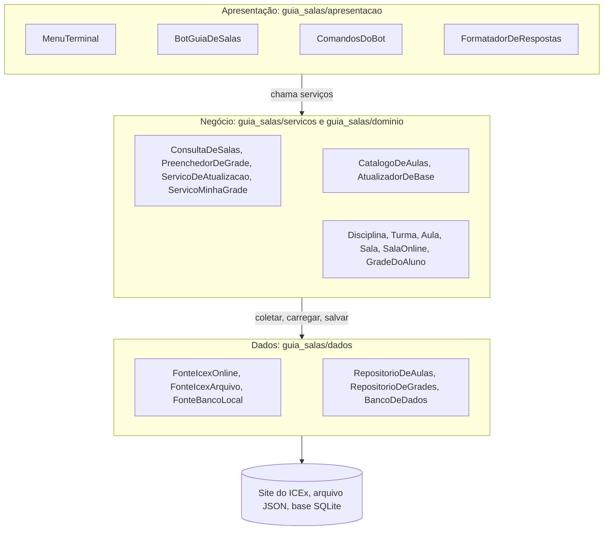
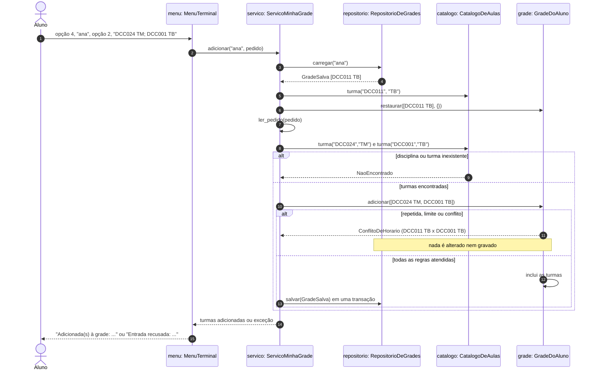
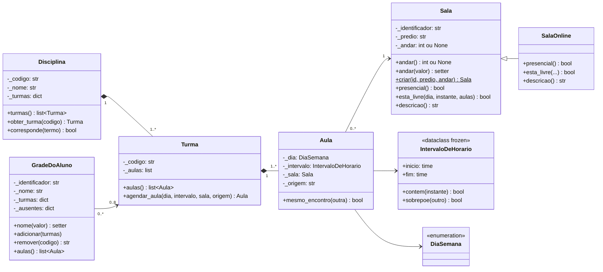
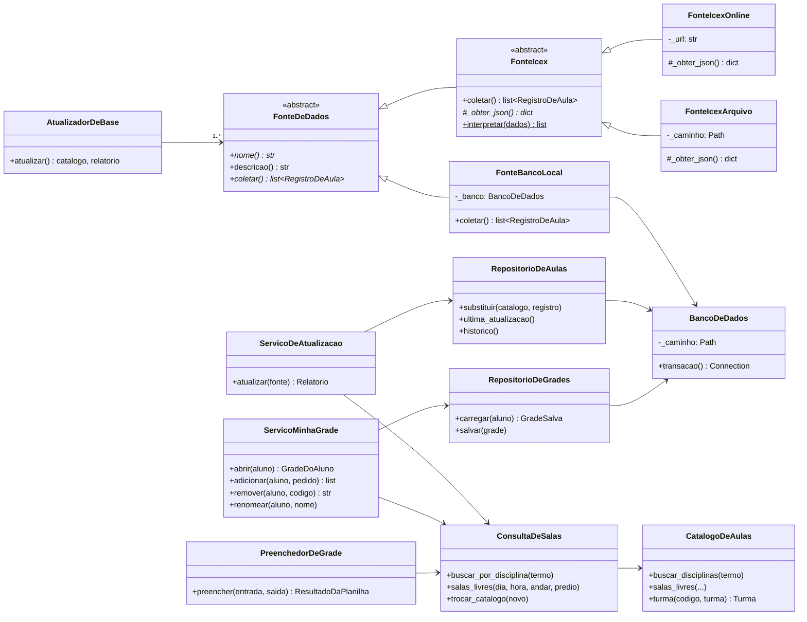
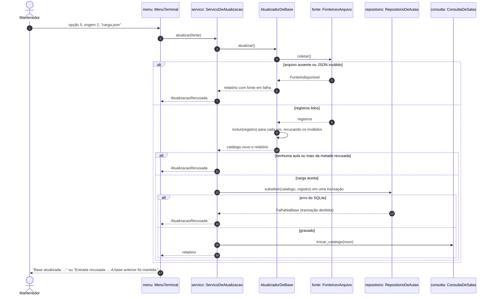

# Guia de Salas: Produto final (4ª etapa)

Natan Gaspar de Souza

**Versão entregue:** 1.0.0, arquivo `guia-salas-1.0.0.zip` (SHA-256 `7e06d28c73761ade0cdc62561dcd7104d900cbacec215b65bfa205e53f7f0e56`), gerado a partir do commit `41aee24` do repositório. Python 3.10 ou superior (testado com 3.13.18).

## 1. Problema, público e escopo

**Problema.** Para saber em que sala e horário acontece uma disciplina, o aluno consulta sites institucionais lentos, um por unidade, e repete a busca a cada mudança. Também não há uma forma simples de descobrir uma sala vazia para estudar entre duas aulas.

**Público.** Alunos que têm aulas nas salas distribuídas pelo ICEx (prédio do ICEx e CAD1, CAD2 e CAD3), que usam o sistema pelo terminal ou pelo bot do Telegram. O mantenedor (o grupo) atualiza a base de aulas.

**Escopo.** O sistema reúne em uma base local o quadro "Distribuição de Salas" do ICEx e responde, sem depender do site no momento da consulta: onde é a aula de uma disciplina, quais salas estão livres, qual é a sala de cada disciplina de uma planilha e qual é a semana de aulas do aluno.

### 1.1 Ajustes de escopo

| Ajuste | Justificativa |
|---|---|
| Somente o quadro do ICEx; a Escola de Engenharia ficou fora. | O endereço dos dados da Engenharia não foi identificado. A interface `FonteDeDados` permite incluí-la como nova subclasse, sem mudar as consultas. |
| Grade enviada só como planilha .xlsx, sem imagem. | Imagem exigiria reconhecimento de texto (OCR), fora do tempo da disciplina. |
| Dados reais do ICEx no lugar de dados fictícios. | O JSON público do ICEx foi lido diretamente. Só a grade de exemplo (`ana`) é fictícia. |
| Nova funcionalidade F05, Minha grade. | Completa o objetivo da proposta ("enviar a grade e receber as salas"): o aluno guarda suas turmas uma vez e consulta a semana inteira. É a funcionalidade que altera dados com regras de negócio. |
| Atualização da base (F04) manual no terminal e automática no bot. | No terminal, o mantenedor escolhe a origem (site ou arquivo); no bot, a atualização roda logo após o início e a cada 60 minutos. |

## 2. Funcionalidades

| ID | Funcionalidade | Origem | Quem solicita | Resultado para o usuário |
|---|---|---|---|---|
| F01 | Buscar a sala de uma disciplina pelo nome ou código | Protótipo | Aluno | Turmas da disciplina com dias, horários, sala, prédio e andar. |
| F02 | Consultar salas livres num dia, hora, andar e prédio | Protótipo | Aluno | Lista de salas presenciais sem aula naquele instante. |
| F03 | Preencher planilha de disciplinas | Nova (o código existia no bot, sem validação nem testes) | Aluno | Cópia da planilha com turma, dias e horários e sala de cada disciplina. |
| F04 | Atualizar a base de aulas | Nova (no protótipo a base era só memória) | Mantenedor ou bot | Base trocada pela carga nova, com histórico; ou recusa com a base anterior mantida. |
| F05 | Minha grade: adicionar turmas, ver a semana, remover disciplina e alterar o nome | Nova | Aluno | Grade salva, sem conflito de horário, mostrada dia a dia com as salas. |

**Como iniciar.** `python -m guia_salas` abre o menu do terminal com as opções 1 a 5. `python -m guia_salas --telegram` inicia o bot (comandos `/sala`, `/livres`, `/minhagrade`, `/adicionar`, `/remover` e envio de planilha). `python -m guia_salas --preparar-base` recria a base de demonstração.

**Funcionalidades opcionais.** O bot do Telegram é uma segunda interface para as mesmas funcionalidades; o terminal é suficiente para todas. A opção `--online` atualiza pelo site antes de abrir o menu.

**Pendências que afetam a versão entregue.** "Seg-Sex" no quadro é lido como segunda e sexta (não como segunda a sexta), a confirmar com o ICEx; abreviações como "BD" e "GAAL" não são reconhecidas; salas sem nenhuma aula no semestre nunca aparecem como livres.

## 3. Contratos

Em todos os contratos, "base" é o arquivo SQLite `base/guia_salas.db` e "catálogo" é a cópia em memória das aulas da base. Toda recusa lança uma subclasse de `ErroDeDominio`; o terminal mostra "Entrada recusada: motivo" e o bot mostra o motivo, e o menu continua.

### F01. Buscar a sala de uma disciplina

| Item | Contrato |
|---|---|
| Condições iniciais | Base com aulas carregadas (a demonstração tem 30 disciplinas e 199 aulas). |
| Dados informados | Termo (texto livre): nome ou código da disciplina. |
| Regras | Pelo menos 3 caracteres após remover espaços. Corresponde pelo código exato (sem diferenciar maiúsculas) ou se cada palavra do termo for igual ou início (com 3 letras ou mais) de uma palavra do nome. Acentos e maiúsculas são ignorados, e os algarismos 1 a 9 equivalem aos romanos I a IX. |
| Sucesso | Lista de disciplinas, cada uma com suas turmas, dias, horário (HH:MM, horário de Brasília), sala, prédio e andar. Sem correspondência, a resposta vazia é válida: "Nenhuma disciplina encontrada para ...". |
| Rejeição | Termo com menos de 3 caracteres (`TermoDeBuscaInvalido`). |
| Dados | Nada muda: consulta somente leitura. |

### F02. Consultar salas livres

| Item | Contrato |
|---|---|
| Condições iniciais | Base com aulas carregadas. Só são conhecidas as salas que aparecem em alguma aula. |
| Dados informados | Dia (seg a sab); hora (HH:MM, horário de Brasília); andar (inteiro; vazio para todos); prédio (ICEx, CAD1, CAD2, CAD3; vazio para todos). |
| Regras | Uma sala está ocupada se alguma aula a usa no dia com início ≤ hora < fim (o fim é exclusivo). Turmas conjuntas ocupam a sala uma vez. Sala on-line nunca é livre. |
| Sucesso | Lista de salas livres com prédio, ordenada por prédio, andar e nome. Lista vazia é válida: "Nenhuma sala livre ...". |
| Rejeições | Dia desconhecido, hora fora de 00:00 a 23:59 ou em outro formato, andar não numérico ou negativo (`DadoInvalido`); prédio que não existe na base (`PredioDesconhecido`, com a lista de prédios válidos). |
| Dados | Nada muda. |

### F03. Preencher planilha de disciplinas

| Item | Contrato |
|---|---|
| Condições iniciais | Base com aulas carregadas; biblioteca `openpyxl` instalada. |
| Dados informados | Caminho de uma planilha .xlsx. A linha 1 é o cabeçalho; a coluna 1 traz o nome ou código de cada disciplina; uma coluna chamada "Turma" (opcional) escolhe a turma. |
| Regras | Cada linha é buscada pela regra da F01. Com turma informada, só ela é aceita; sem turma, usa a primeira turma da disciplina. Linhas não encontradas não interrompem as demais. |
| Sucesso | Cópia gravada ao lado da original, com o sufixo `_com_salas`, com três colunas novas (Turma encontrada, Dias e horários, Sala); linhas não encontradas recebem "não localizada". Mostra os totais de localizadas e não localizadas. |
| Rejeições | Extensão diferente de .xlsx, arquivo inexistente, arquivo que não é planilha, planilha sem disciplinas, saída igual à entrada, falha ao gravar (`PlanilhaInvalida`). Nenhuma cópia é criada. |
| Dados | A planilha original e a base não mudam. |

### F04. Atualizar a base de aulas

| Item | Contrato |
|---|---|
| Condições iniciais | Base aberta (pode estar vazia na primeira execução). |
| Dados informados | Origem: 1 para o site do ICEx (`recupera_salas.php`) ou 2 para um arquivo JSON no mesmo formato. |
| Regras | Cada registro é validado (dias reconhecidos, início anterior ao fim, sala com identificador, sem aulas sobrepostas na mesma turma); registros inválidos são recusados um a um. A carga inteira é recusada se a fonte falhar, se nenhuma aula for válida ou se mais da metade dos registros lidos for recusada. Exatamente metade recusada ainda é aceita. |
| Sucesso | Numa única transação, as tabelas de disciplinas, turmas, salas e aulas são substituídas e uma linha é acrescentada ao histórico (data e hora, origem, lidos, registradas, recusados). Em seguida, as consultas passam a usar o catálogo novo. Mostra os totais. |
| Rejeições | `AtualizacaoRecusada` com o motivo: fonte indisponível, JSON em formato inesperado, carga sem aulas, proporção de recusas acima do limite, falha do SQLite ao gravar. |
| Dados | Na recusa, base e catálogo ficam como estavam (a transação é desfeita). Em qualquer caso, as grades dos alunos são preservadas; turmas que deixaram de existir aparecem como "Não encontradas na base atual". |

### F05. Minha grade

| Item | Contrato |
|---|---|
| Condições iniciais | Base com aulas carregadas. A grade é identificada por um apelido no terminal (2 a 40 letras sem acento, números, ponto, hífen, sublinhado) ou pela conversa no Telegram (`telegram:<id>`). A demonstração traz a grade `ana`. |
| Dados informados | Adicionar: uma ou mais disciplinas com turma, como `DCC011 TB; MAT001 TA1` (separadas por ponto e vírgula, vírgula ou linha). Remover: código da disciplina. Alterar nome: texto de 1 a 40 caracteres. |
| Regras | No máximo uma turma por disciplina e no máximo 8 disciplinas; um pedido tem no máximo 8 itens. Disciplina e turma precisam existir na base. Duas aulas de turmas diferentes da grade não podem se sobrepor no mesmo dia (aulas encostadas, como 09:10 e 09:10, são permitidas; aulas on-line também contam). O pedido é atendido por inteiro ou recusado por inteiro. |
| Sucesso | Adicionar grava todas as turmas do pedido; ver mostra as aulas da semana por dia, com horário, disciplina, turma e sala; remover retira a disciplina; alterar nome troca o nome exibido. |
| Rejeições | Pedido vazio ou fora do formato CÓDIGO TURMA, identificação ou nome inválidos (`DadoInvalido`); disciplina ou turma inexistente, remoção de disciplina fora da grade (`NaoEncontrado`, com as turmas existentes); disciplina repetida no pedido ou já na grade (`Duplicidade`); mais de 8 disciplinas (`LimiteExcedido`); conflito de horário (`ConflitoDeHorario`, indicando as duas aulas); falha do SQLite (`GravacaoFalhou`). |
| Dados | Na recusa, nenhuma turma do pedido é gravada e a grade fica como estava, inclusive quando o pedido tinha várias turmas válidas. As aulas da base não mudam. |

## 4. Camadas e colaboração

O código está dividido em três camadas, uma por pacote. Cada camada só conhece a de baixo; o módulo `sistema.py` monta os objetos e entrega o mesmo `Sistema` ao terminal e ao bot.



<p class="legenda">Figura 1. Camadas e pacotes.</p>

| Camada | Módulos e classes | Responsabilidade |
|---|---|---|
| Apresentação | `apresentacao/terminal.py` (`MenuTerminal`), `apresentacao/comandos.py` (`ComandosDoBot`), `apresentacao/telegram_bot.py` (`BotGuiaDeSalas`), `apresentacao/formatacao.py` (`FormatadorDeRespostas`) | Ler entradas, converter textos (hora, dia, andar), chamar um serviço e mostrar o resultado ou o motivo da recusa. Não contém regras. Só `telegram_bot.py` importa a biblioteca do Telegram. |
| Negócio | `servicos/` (`ConsultaDeSalas`, `CatalogoDeAulas`, `PreenchedorDeGrade`, `ServicoDeAtualizacao`, `AtualizadorDeBase`, `ServicoMinhaGrade`) e `dominio/` (entidades, valores e exceções) | Aplicar as regras e coordenar as operações: validar antes de alterar, decidir o que é aceito e pedir a gravação. |
| Dados | `dados/` (`FonteDeDados` e subclasses, `BancoDeDados`, `RepositorioDeAulas`, `RepositorioDeGrades`) | Obter registros brutos das fontes e guardar ou recuperar linhas do SQLite. Não conhece as regras do domínio. |

**MVC.** O projeto não segue MVC à risca, mas há correspondência: o Model é a camada de negócio com o domínio; a View é o `FormatadorDeRespostas`, que transforma resultados em texto; o Controller é o `MenuTerminal` ou o `ComandosDoBot`, que recebe o pedido, chama o serviço e escolhe a resposta. A camada de dados fica abaixo do Model.

**Colaboração em uma operação (F05, adicionar).** O menu lê o pedido e chama `ServicoMinhaGrade.adicionar`. O serviço abre a grade (o repositório devolve os códigos salvos e o catálogo devolve os objetos `Turma`), procura no catálogo cada turma do pedido, pede a `GradeDoAluno.adicionar` que aplique as regras e, só se todas passarem, manda o `RepositorioDeGrades` gravar numa transação. O formatador monta a confirmação.

PAISAGEM_INICIO



<p class="legenda">Figura 2. Sequência da F05 (adicionar turmas). Com o pedido do exemplo, DCC001 TB conflita com DCC011 TB na segunda, 09:25, e DCC024 TM também não é gravada.</p>

PAISAGEM_FIM

PAISAGEM_INICIO

## 5. Diagrama de classes



<p class="legenda">Figura 3. Classes do domínio. A grade referencia turmas do catálogo; não as possui.</p>

PAISAGEM_FIM

PAISAGEM_INICIO



<p class="legenda">Figura 4. Serviços (negócio) e classes da camada de dados.</p>

PAISAGEM_FIM

### 5.1 Requisitos de orientação a objetos

| Requisito | Onde aparece |
|---|---|
| Classes de domínio com responsabilidade relevante | `Disciplina` (decide se corresponde ao termo), `Turma` (impede aulas sobrepostas da mesma turma), `Sala` (decide se está livre), `GradeDoAluno` (limite, repetição e conflito), `IntervaloDeHorario` (início antes do fim, sobreposição). |
| Estado encapsulado | Atributos com prefixo `_`, lidos por `@property`. Listas são devolvidas como cópias (`turmas`, `ausentes`), então quem lê não altera o objeto. |
| Getters e setters | Atributos que admitem alteração direta têm setter com validação: `Sala.andar` (inteiro não negativo ou desconhecido; o construtor também passa por ele) e `GradeDoAluno.nome` (1 a 40 caracteres). Códigos e identificadores, que identificam o objeto, são somente leitura. |
| Operações de domínio | Alterações com regra usam métodos próprios, nunca setters: `GradeDoAluno.adicionar` e `remover`, `Turma.agendar_aula`, `ConsultaDeSalas.trocar_catalogo`, `ServicoDeAtualizacao.atualizar`. |
| Classe abstrata | `FonteDeDados` (contrato de toda fonte: `nome` e `coletar()`) e `FonteIcex` (Template Method: converte o JSON e deixa `_obter_json()` para as subclasses). |
| Herança por especialização | `FonteIcexOnline` e `FonteIcexArquivo` especializam `FonteIcex`; `FonteBancoLocal` especializa `FonteDeDados`; `SalaOnline` especializa `Sala`; as exceções especializam `ErroDeDominio`. |
| Polimorfismo | `AtualizadorDeBase` chama `fonte.coletar()` sem saber se a fonte é o site, um arquivo ou a base local. `CatalogoDeAulas.salas_livres` chama `sala.esta_livre()` e a `SalaOnline` responde sempre que não; `descricao()` também muda por classe. A interface trata qualquer recusa com um único `except ErroDeDominio`. |

## 6. Diagramas de sequência

A sequência da F01 é a mesma do protótipo; muda só a entrada, que agora vem do `Sistema` montado com a base SQLite. A F05 está na Figura 2. A Figura 5 mostra a F04, que envolve várias tabelas e precisa preservar o estado quando é recusada.

PAISAGEM_INICIO



<p class="legenda">Figura 5. Sequência da F04 com os caminhos de recusa.</p>

PAISAGEM_FIM

A F02 e a F03 seguem o mesmo padrão: o menu converte as entradas, chama `ConsultaDeSalas.salas_livres` ou `PreenchedorDeGrade.preencher`, recebe objetos ou uma exceção e passa o resultado ao formatador.

## 7. Base de dados

A base é um arquivo SQLite (módulo `sqlite3` da biblioteca padrão), escolhido no protótipo por não exigir servidor e caber no Raspberry Pi onde o bot roda.

| Tabela | Conteúdo |
|---|---|
| `disciplina` | código (chave) e nome |
| `turma` | disciplina e código, únicos juntos |
| `sala` | prédio, identificador (únicos juntos) e andar (pode ser nulo) |
| `aula` | turma, sala, dia (SEG a SAB), início, fim e origem |
| `atualizacao` | histórico de cargas aceitas: data e hora, origem, lidos, aulas registradas, recusados |
| `grade` | identificador do aluno (chave) e nome da grade |
| `grade_turma` | aluno, código da disciplina e código da turma |

**Inicialização.** O ZIP traz `base/guia_salas.db` já preenchida. O comando `python -m guia_salas --preparar-base` refaz a carga a partir de `guia_salas/dados/amostra_icex.json` (110 registros reais do ICEx de 15/10/2026: 30 disciplinas, 199 aulas, 42 salas presenciais) e cria a grade fictícia `ana` (DCC011 TB, MAT038 TB1, MAT001 TA1). Se o arquivo não existir, o programa faz isso sozinho na primeira execução.

**Uso no programa.** Ao iniciar, a `FonteBancoLocal` lê as aulas gravadas e o `AtualizadorDeBase` monta o catálogo em memória, que responde às consultas. A F04 grava na base antes de trocar o catálogo. A F05 lê e grava a grade a cada operação.

**Base de teste.** Os testes criam, para cada caso, uma base nova numa pasta temporária, carregada de `tests/dados/`; a base de demonstração nunca é usada.

**Simulações.** O site do ICEx não é simulado no uso normal: a opção 1 da F04 baixa os dados reais. O arquivo JSON local (`FonteIcexArquivo`) reproduz a resposta do site, no mesmo formato, para uso sem internet. Nos testes, uma sessão HTTP falsa substitui a conexão e devolve o JSON de teste ou simula o site fora do ar.

## 8. Tratamento de erros

| Situação | Onde é tratada | Resposta | Estado |
|---|---|---|---|
| Hora "25:00", "14" ou "dez horas" | `ler_hora` (conversão) | "Horário inválido: '25:00'" | Sem alteração |
| Andar "dois" | `MenuTerminal.ler_andar` (conversão) | "Andar inválido: "dois". Use um número, como 2." | Sem alteração |
| Dia "domingo", prédio "CAD9", andar -1 | `DiaSemana`, `ConsultaDeSalas` | Motivo e valores válidos | Sem alteração |
| Planilha inexistente, corrompida ou vazia | `PreenchedorDeGrade` | Motivo; nenhuma cópia criada | Original preservada |
| Pedido da grade com uma turma inválida entre várias | `ServicoMinhaGrade` e `GradeDoAluno` | Motivo do item recusado | Nenhuma turma do pedido gravada |
| Carga com fonte fora do ar ou formato inválido | `ServicoDeAtualizacao` | Motivo e "A base anterior foi mantida." | Base e catálogo preservados |
| Erro do SQLite no meio da gravação | `BancoDeDados.transacao` | `FalhaNaBase` convertida em recusa | Transação desfeita |
| Erro inesperado no bot | tratador de erros do `BotGuiaDeSalas` | "Não foi possível responder agora." | Registro no log |

## 9. Decisões de projeto

- **As regras ficam na camada de negócio.** O conflito de horário está em `GradeDoAluno` e a regra de sala ocupada em `Sala.esta_livre` e `IntervaloDeHorario`. O terminal e o bot chamam os mesmos serviços, então aceitam e recusam exatamente os mesmos pedidos. A mesma `IntervaloDeHorario.sobrepoe` decide conflito na turma (carga da base) e na grade do aluno, e `contem` decide ocupação na F02.
- **Validar tudo antes de alterar.** `GradeDoAluno.adicionar` confere repetição, limite e conflito para o pedido inteiro e só então inclui as turmas; `ServicoDeAtualizacao` confere a carga antes de gravar e grava antes de trocar o catálogo. Assim, uma recusa nunca deixa metade da operação feita.
- **Transação para operações com vários registros.** A F04 apaga e regrava quatro tabelas e a F05 regrava todas as linhas de uma grade; ambas usam uma única transação do SQLite, desfeita em caso de erro.
- **Grade guarda códigos, não referências às aulas.** A base de aulas é substituída a cada atualização; se a grade apontasse para linhas de `aula`, perderia os dados. Guardando "DCC011 TB", a grade sobrevive à atualização, e uma turma que sumiu do quadro aparece como pendente em vez de desaparecer.
- **Catálogo em memória com base persistente.** As consultas percorrem objetos em memória (rápido e testável sem banco); o SQLite garante que o sistema abra com a última base aceita mesmo com o site do ICEx fora do ar.
- **`SalaOnline` como especialização.** Antes, cada consulta testava o nome do prédio. Agora a própria sala responde se está livre e como se descreve, e as consultas não precisam de condição especial.
- **Formatador separado.** Os textos ficam em `FormatadorDeRespostas`; terminal e bot mostram as mesmas respostas, e mudar um texto não afeta regras.

## 10. Como executar e testar

```text
pip install -r requirements.txt
python -m guia_salas --preparar-base       (opcional: o ZIP já traz a base)
python -m guia_salas
python -m unittest discover -s tests -v
```

São 85 testes `unittest` em 8 arquivos (`test_f01_busca.py` a `test_f05_minha_grade.py`, `test_dominio.py`, `test_fontes.py`, `test_menu.py`), todos aprovados na versão 1.0.0. Cada teste prepara a própria base temporária, então a execução não depende da ordem. A verificação detalhada por funcionalidade será apresentada no documento da 5ª etapa.

**Conteúdo do ZIP.** `guia_salas/` (código-fonte e amostra), `base/guia_salas.db` (base preenchida), `tests/` (testes e dados de teste), `exemplos/grade_exemplo.xlsx`, `scripts/baixar_dados_icex.py`, `deploy/` (instalação do bot no Raspberry Pi), `README.md`, `requirements.txt` e `.env.example` (sem token). Não há ambiente virtual, senhas nem dados pessoais.

## 11. Limitações conhecidas

- Somente as salas do quadro do ICEx; a Escola de Engenharia não está incluída.
- Salas sem nenhuma aula no semestre não são conhecidas e nunca aparecem como livres.
- "Seg-Sex" é lido como segunda e sexta; a interpretação ainda não foi confirmada com o ICEx.
- A busca não reconhece abreviações ("BD", "GAAL"). Na F03, quando o termo corresponde a mais de uma disciplina, usa a primeira em ordem de código.
- O limite de 8 disciplinas por grade foi definido pelo grupo, sem norma da UFMG.
- A grade no terminal é identificada por um apelido, sem senha; qualquer pessoa que use o mesmo computador e apelido acessa a mesma grade.
- O bot depende de o Raspberry Pi estar ligado e com internet; sem internet, continua respondendo com a última base gravada.
- O download pelo site não pôde ser executado no ambiente usado para gerar este relatório (rede bloqueada). No Raspberry Pi, o bot baixou a lista completa do ICEx (997 registros) com a mesma `FonteIcexOnline`.
